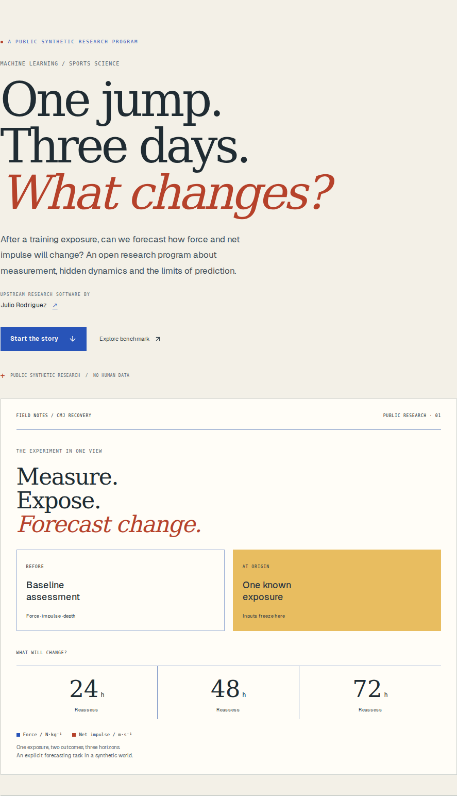
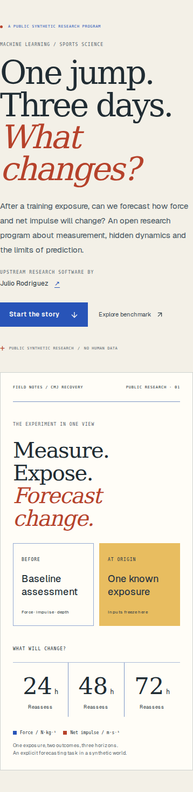

# Recovery Observatory

**An interactive exhibition of synthetic countermovement-jump recovery research.**

Recovery Observatory is a static-first research showcase about one question: after a training exposure, can we forecast how mean force and net impulse will change over the following three days? It introduces the measurement, synthetic study design, model comparisons, research history and scientific limits in one navigable story.

The title and visual identity are provisional. The exhibit is a portfolio and research-communication site, not an athlete assessment, coaching tool or accepted recovery score. It contains no human records, backend, authentication, model training or live inference.

| Desktop | Mobile |
| --- | --- |
|  |  |

## Take a 90-second tour

1. Choose **Start the story** and follow the short route through the research question.
2. In the Synthetic Episode Theater, switch between the forecast-origin and later-observer views. Scrub the events and open the methods notes to see which information is available to a forecast.
3. Follow the eight source-defined formulations. Open a node to inspect its question, status, parent evidence and limitations.
4. In the explorer, select a model, root, horizon, outcome and metric. Every plotted value comes from the pinned receipt; the 3D view and exact-value matrix use the same controls.
5. Open the Recovery Lab to change two mathematical modes and inspect their response, derivative and signed integral. These curves are illustrations, not model predictions.

The persistent 3D stage follows the story on desktop and moves above it on mobile. Scrolling remains native. Reduced motion, unavailable WebGL and graphics-context loss retain text, 2D plots and exact numerical alternatives. [The screenshot gallery](docs/SCREENSHOTS.md) shows desktop and mobile chapters and expanded research states.

## Run locally

Use Node.js 22 and npm. No environment variables, API keys, private datasets or Python setup are needed for the site.

```sh
npm ci
npm run dev
```

Open <http://localhost:3000>. The fixture generator uses only the pinned source files in this repository; `npm run build` verifies their checksums and rejects stale generated JSON before exporting the site.

```sh
npm test
npm run typecheck
npm run build
npx playwright install --with-deps chromium
npm run test:ui
```

The browser suite expects the production build from `npm run build`. It starts an isolated static server on `127.0.0.1:4174` so an existing development server cannot be mistaken for the production export. The complete browser run checks all 96 model/root/horizon/outcome views, mobile/touch states, accessibility, reduced motion and WebGL fallbacks.

`npm run build` writes the deployable static site to `out/`. To inspect it manually:

```sh
python3 -m http.server 4173 --directory out
```

Open <http://localhost:4173>. The export can be served by any static file host; see [deployment notes](docs/DEPLOYMENT.md).

## Scientific source and limits

The exhibition cites and preserves scientific source materials from [`Litju/CMJRecoveryDynamicsBench`](https://github.com/Litju/CMJRecoveryDynamicsBench) at immutable commit [`3dc4c82f0c948add6e4a9ebdebfd227933c823d3](https://github.com/Litju/CMJRecoveryDynamicsBench/tree/3dc4c82f0c948add6e4a9ebdebfd227933c823d3). It presents precomputed receipts; it does not execute the Python generators, reproduce a historical private campaign, fit models in the browser or infer athlete outcomes.

The active fixed-mode comparison is a **new synthetic diagnostic study** with three public roots generated by the same declared world. Its six-cell mean NRMSE is not empirical evidence, an out-of-distribution guarantee or a production benchmark score. The eight historical formulations have partial exact-replay authority. The retired rich-history raw-progress result is a different experiment and is excluded from the active NRMSE comparison. See [scientific provenance and interpretation](docs/SCIENCE_AND_DATA.md) for the metric definition, lineage, receipt hashes and claim boundaries.

## Project map

| Path | Role |
| --- | --- |
| `src/app/` | Single-page App Router entry, metadata and styles |
| `src/components/` | Story, measurements, lineage, explorer, mathematical lab and optional WebGL scenes |
| `src/lib/` | Receipt selectors, chart geometry, chapter state and mathematical calculations |
| `src/data/` | Build-time JSON fixtures imported by the page and components |
| `source/` | Read-only scientific source snapshots, receipts, manifests and citation metadata |
| `scripts/prepare-data.mjs` | Verifies pinned source hashes and deterministically writes the public fixtures |
| `tests/` | Scientific assertions and production-browser interaction/accessibility checks |
| `docs/` | Architecture, science, deployment, validation and screenshots |

[Architecture details](docs/ARCHITECTURE.md) explain how those parts connect.

## Attribution and licensing

The preserved scientific software identifies Julio Rodriguez as its author in [`source/CITATION.cff`](source/CITATION.cff) and carries its upstream Apache-2.0 license at [`source/LICENSE`](source/LICENSE). That license is for the scientific source it accompanies; it does **not** license this showcase's TypeScript, CSS, tests, documentation or screenshots.

The showcase itself currently has no root `LICENSE` file, so no reuse license for its original contents is granted by this checkout. The locally served Geist font is accompanied by its SIL Open Font License in [`public/fonts/OFL.txt`](public/fonts/OFL.txt). Runtime and development packages are pinned in `package-lock.json`; their license identifiers are package metadata, and their code is installed from npm rather than vendored here. Details and the public-release license gate are recorded in [the release checklist](docs/RELEASE_CHECKLIST.md).

Direct runtime dependencies in the lockfile are Next.js 16.4.2, React/React DOM 19.3.1, React Three Fiber 9.8.2, Three.js 0.180.0, Recharts 3.10.1, Lucide React 0.468.0, Tailwind CSS 4.3.3 and `@tailwindcss/postcss` 4.3.3. The lockfile reports MIT for these packages except Lucide React (ISC). Development tooling includes TypeScript 5.9.3, Playwright 1.64.1 and axe-core Playwright 4.14.0 (MPL-2.0 metadata). `npm audit` reported no known vulnerabilities at the readiness check; this is time-specific and should be rerun before a later launch.

The lockfile also contains Next.js's optional Sharp/libvips image packages; some platform package metadata declares LGPL-3.0-or-later. This app has no `next/image` import and the static export does not bundle Sharp. The exact package and license metadata remains in `package-lock.json`; review it again before changing image handling or shipping bundled dependencies.

## Release state

This repository is a local release candidate. It has no configured Git remote, no approved showcase repository URL and no production hostname. Its metadata intentionally blocks indexing while the site remains unpublished. The Vercel project/account access check is unresolved. The scientific Python release and its PR #8 are separate from this site and are not changed here.

See [current validation evidence](docs/VALIDATION.md), [deployment readiness](docs/DEPLOYMENT.md) and the [release decision](docs/RELEASE_CHECKLIST.md). No public repository, deployment, domain, release or tag has been created by this work.
